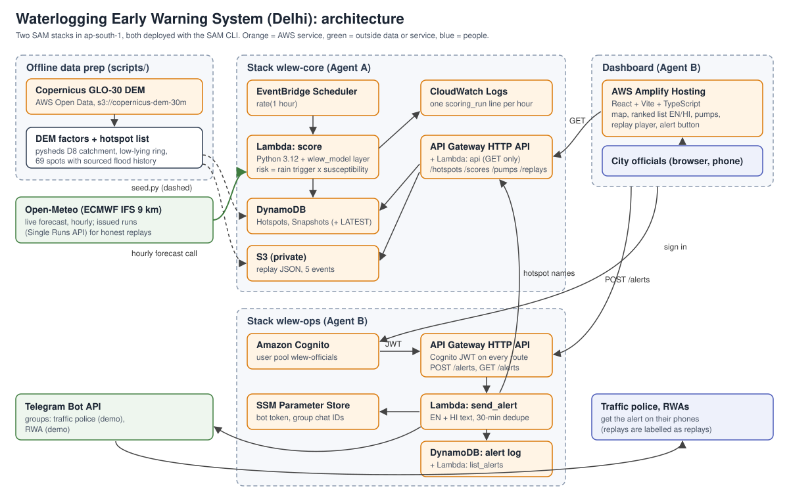

# Waterlogging Early Warning System (Delhi)

Every monsoon, the same Delhi underpasses and junctions flood: Minto Bridge, Pragati Maidan tunnel, ITO, Dhaula Kuan. Buses get stuck, ambulances get diverted, and the traffic police and pump crews usually learn about it from news reports and social media after the water is already there.

This project scores 69 known Delhi waterlogging hotspots every hour from the rain forecast and each spot's terrain and history. It shows the risk on a dashboard for city officials, plans where to send a limited number of pumps, and sends a one-click warning in English and Hindi to Telegram groups for the traffic police and resident welfare associations (RWAs). A replay player re-runs past storms using only the forecasts that existed at each hour, so the warning time it shows is honest.

Built for the WeMakeDevs x AWS Environmental Hacks (Heat and Water track).

| | |
|---|---|
| **Dashboard** | https://main.d3so27hxydwx7o.amplifyapp.com (sign-in for officials; `?present=1` opens the headline replay) |
| **Public read API** | https://x6klvfqev1.execute-api.ap-south-1.amazonaws.com (`/health`, `/hotspots`, `/scores/latest`, `/pumps?count=6`, `/replays`) |
| **Write-up** | [docs/writeup.md](docs/writeup.md) |
| **API contract** | [contract/CONTRACT.md](contract/CONTRACT.md) |

## How the score works

```
Risk = RainTrigger x Susceptibility
```

**RainTrigger** (0 to 1) says how hard it is about to rain at the spot:

- I is the highest hourly forecast rain over the current hour and the next 6 (mm/h).
- A is the rain over the last 24 hours (mm). Wet ground floods faster, so I is boosted: `I_eff = I x (1 + k x min(A / A_sat, 1))`.
- `RainTrigger = clip((I_eff - I0) / (I1 - I0), 0, 1)`, with I0 = 4 mm/h and I1 = 20 mm/h after tuning.

**Susceptibility** (0 to 1) says how badly the spot floods when it rains: `0.45 x History + 0.40 x LowLying + 0.15 x Catchment`.

- **History**: how many monsoon seasons from 2019 to 2025 had a documented waterlogging report at the spot (5 or more = 1).
- **LowLying**: how far the spot sits below the ground 150 to 400 m around it, from the Copernicus 30 m elevation model (3 m or more = 1). Underpasses get at least 0.9, because a 30 m model can't see the cut.
- **Catchment**: how much land drains towards the spot (D8 flow accumulation on the same elevation model, log scale; 1 hectare = 0, 5 km² = 1).

**Levels**: LOW below 0.15, WATCH, HIGH from 0.35, CRITICAL from 0.60. The city status comes from the highest rain trigger: STANDBY, RAIN_WATCH, ALERT (0.40) and SEVERE (0.75), so the city can be on alert before any single spot turns red.

**Pumps**: one pump to each HIGH or CRITICAL spot in rank order, then a second to CRITICAL spots, then one to WATCH spots. Spots at HIGH or above with no pump left are listed as unassigned.

The full definitions and a worked example are in [contract/CONTRACT.md](contract/CONTRACT.md). The model code is pure Python with no AWS imports ([model/wlew_model](model/wlew_model)), and the parameters are in [model/params.json](model/params.json).

## Does it work? Replays of real storms

A replay frame at hour *t* uses only forecasts issued before *t*: ECMWF IFS 9 km runs from Open-Meteo's Single Runs API, with each run counted only from 6 hours after it starts. "First report" means the publication time of the first news article naming the spot. That's later than the flooding itself, so every lead time below is an upper bound. Full method and caveats: [model/README.md](model/README.md).

| Storm | Reported spots | Flagged HIGH before the report | Median lead (upper bound) | Flagged, no report found |
|---|---|---|---|---|
| 28 Jun 2024 (228 mm at Safdarjung) | 14 | 3 | 10.6 h | 7 |
| 31 Jul 2024 | 8 | 3 | 23.1 h (inflated by next-day articles) | 24 |
| 7 Aug 2026 | 8 | 2 | 27.5 h (inflated by next-day articles) | 27 |
| 25 Aug 2026 | 7 | **0: a miss** | none | 0 |
| 10 Sep 2026 (dry control) | 0 | 0 | none | 0 |

- **28 Jun 2024 is the headline.** The city left STANDBY at 21:30 IST on 27 Jun, and the first spots turned HIGH at 23:30 IST, about 3.5 hours before the stated 03:00 rain start. Pragati Maidan tunnel, ITO and Tilak Bridge were flagged before their first reports.
- **25 Aug 2026 is an honest miss.** No issued ECMWF run forecast more than 4.1 mm/h, against about 72 mm reported in under two hours. The city reached ALERT, but no spot went above WATCH. A 9 km forecast model doesn't see short convective bursts, and we didn't tune the model to hide that.
- **The dry day stays all LOW and STANDBY** in every frame.

## Architecture



Two AWS SAM stacks in `ap-south-1`, every resource tagged `Project=wlew`:

- **`wlew-core`** (read side): EventBridge Scheduler runs the scoring Lambda every hour. The Lambda makes one batched Open-Meteo call for the 16 forecast cells covering the 69 spots and writes the snapshot to DynamoDB. Replays (too big for DynamoDB items) live in a private S3 bucket. A public, GET-only HTTP API serves hotspots, the latest scores, the pump plan and replays. The model ships as a Lambda layer.
- **`wlew-ops`** (write side): a Cognito user pool for officials (no self sign-up), and an HTTP API with a Cognito JWT on every route. `POST /alerts` renders the warning in English and Hindi, sends it to the Telegram groups, deduplicates repeats within 30 minutes, and logs it in DynamoDB. The bot token and chat IDs live only in SSM Parameter Store.
- **Dashboard**: React + Vite + TypeScript on AWS Amplify Hosting. It has a map with a different marker shape per level (colour is never the only signal), a ranked list in English or Hindi, a "why is this spot at risk" panel, the pump planner, the replay player and the alert button. It works at 375 px wide.

No EC2, NAT Gateway, RDS or SageMaker endpoints: everything is pay-per-request, and a $20 AWS Budget alert watches the account.

## Repository layout

| Path | What | Built by |
|---|---|---|
| `contract/` | API contract, JSON Schemas, fixtures, `validate.py`, `regen_fixtures.py` | Agent C |
| `model/` | Risk engine (pure Python), `params.json`, tuning results | Agent A |
| `data/` | Hotspot list with sources, DEM factors, ground truth, replays | Agent A |
| `scripts/` | DEM download and factors, hotspot build, replay build, tuning, seeding | Agent A |
| `core/` | `wlew-core` SAM stack, scoring and API Lambdas, contract tests | Agent A |
| `ops/` | `wlew-ops` SAM stack, alert Lambdas, message templates, routing | Agent B |
| `frontend/` | Dashboard and the Amplify deploy script | Agent B |
| `demo/` | Video script and shot list | Agent B |
| `handoff/` | Each agent's handoff notes and contract requests | A and B |
| `docs/` | Roadmap, architecture diagram, write-up | Agent C |

## Setup

You need Python 3.12, Node 20 or newer, AWS CLI v2, AWS SAM CLI, and an AWS CLI profile named `wlew` in `ap-south-1`.

```bash
python -m venv .venv
.venv/bin/pip install -r contract/tools/requirements.txt -r model/requirements-dev.txt boto3 pytest
# Windows: .venv\Scripts\pip ... and .venv\Scripts\python

make contract-check PYTHON=.venv/bin/python   # every fixture vs its schema and the risk formulas
cd frontend && npm ci && npm run dev          # dashboard on http://localhost:5173 with fixture data
```

With no `frontend/.env.local`, the dashboard runs on `contract/fixtures/` with a demo sign-in, and alerts are faked in the browser. To use the real APIs, create `frontend/.env.local` (git-ignored) with `VITE_DATA_SOURCE=live` and the stack outputs below.

The DEM, hotspot and replay data are already committed. Rebuilding them is described in [handoff/a.md](handoff/a.md).

## Deploy

Deploy in this order. Preview each stack with a change set before executing it.

1. **`wlew-core`**: `make -C core build` (stages `model/` into the layer, then `sam build`), then `cd core && sam deploy --no-execute-changeset`, read the change set and execute it. `core/samconfig.toml` pins `AllowedOrigin` to the Amplify URL, so the dashboard keeps its CORS access. Then load the data with `python scripts/seed/seed.py`, and optionally score once with `make -C core score`.
2. **Telegram secrets** (once): `aws ssm put-parameter --name /wlew/telegram/bot_token --type SecureString ...` and `/wlew/telegram/groups` (JSON of group key to chat ID). Never put them in git.
3. **`wlew-ops`**: `python ops/stage.py`, then `cd ops && sam build && sam deploy --no-execute-changeset`. `ops/samconfig.toml` holds `CoreApiUrl` and `AllowedOrigin`.
4. **Dashboard**: write `frontend/.env.local` from the stack outputs (`CoreApiUrl`, `OpsApiUrl`, `UserPoolId`, `UserPoolClientId`, plus `VITE_DATA_SOURCE=live`), then run `frontend/scripts/deploy_amplify.sh` from Git Bash or any POSIX shell.
5. **Officials**: `aws cognito-idp admin-create-user ... --temporary-password` (they choose their own password at first sign-in).

If the Amplify app is ever recreated, it gets a new URL. Set it as `AllowedOrigin` on both stacks and redeploy both.

**On Windows**, run `sam` from PowerShell, use `.venv\Scripts\python` (the `python3` command is often the Microsoft Store stub), and strip `\r` from AWS CLI text output in shell scripts. `.gitattributes` keeps `*.sh` files LF so they run in Git Bash. More detail is in [handoff/b.md](handoff/b.md).

## Tests

| Suite | Command | Result at v1.0 |
|---|---|---|
| Contract fixtures (synthetic and real sets) | `make contract-check` | passed |
| Model and core units | `make -C core test` | 24 passed |
| Core API contract tests against the live URL | `pytest core/tests/contract --api <CoreApiUrl>` | 14 passed |
| Ops (fakes for Telegram, DynamoDB, SSM) | `pytest ops/tests` | 23 passed |
| Dashboard (Vitest + Testing Library) | `cd frontend && npm test` | 24 passed |

CI (`.github/workflows/ci.yml`) runs the contract check and the core, ops and frontend suites on every push.

`contract/fixtures/` is a small synthetic set (12 spots, including the contract's worked example) that the dashboard and ops tests use. `contract/fixtures/live/` holds real API responses, regenerated with `make fixtures` and checked against the same formulas.

## Known limits

- **Forecast resolution.** A 9 km forecast model misses short convective bursts (25 Aug 2026). The model, not the formula, is the main limit.
- **Report times are publication times**, so lead times are upper bounds.
- **GLO-30 is a surface model**: spots under flyovers read the deck height and get LowLying = 0. Some drains break at roads, so a few frequently flooded spots get Catchment = 0.
- **The weights were tuned on reports from all four storms**, so they aren't independently tested. The rain parameters were tuned on two storms and checked on the other two.
- **October is dry**, so the live map is normally all LOW and STANDBY. Use the replays to see the system work.
- **Sign-in lasts about an hour** (no token refresh yet), and alerts go to two demo Telegram groups, not real departments.

## Built with AI: Claude Code and three agents

The code was written by three [Claude Code](https://claude.com/claude-code) sessions working in parallel, steered and checked by the team. The plan is in [docs/ROADMAP.md](docs/ROADMAP.md):

- **Agent C (integration)** wrote the shared API contract, its JSON Schemas, fixtures and validator first, then froze it. At the end it merged both branches, checked both stacks against the repo, ran the end-to-end checklist and wrote these docs.
- **Agent A (data, model, core backend)** worked only in `core/`, `model/`, `data/` and `scripts/` on the `agent-a/core` branch.
- **Agent B (dashboard, sign-in, alerts, hosting, demo)** worked only in `ops/`, `frontend/` and `demo/` on the `agent-b/ops` branch.

Each folder had one owner, the two build agents never edited the contract (they filed change requests in `handoff/` instead), and the merges had no conflicts. The humans did what agents can't: AWS and Telegram accounts, secrets, test passwords, approving every AWS change set, and checking the results.

## Data and attributions

- **Elevation**: Copernicus GLO-30 DEM, © DLR e.V. 2010–2014 and © Airbus Defence and Space GmbH 2014–2018, provided under COPERNICUS by the European Union and ESA. Accessed from the [AWS Open Data registry](https://registry.opendata.aws/copernicus-dem/).
- **Geocoding and places**: © [OpenStreetMap](https://www.openstreetmap.org/copyright) contributors (ODbL), via Nominatim. The dashboard map tiles are also © OpenStreetMap contributors.
- **Weather**: [Open-Meteo](https://open-meteo.com/) (CC BY 4.0), using ECMWF IFS forecasts, including the Single Runs and historical forecast APIs.
- **Flood history**: public advisories and news reports. Every hotspot and ground-truth report carries its source URL in `data/`.
