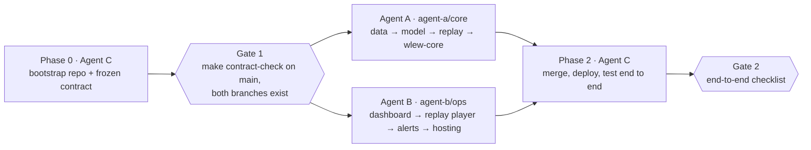

# Waterlogging EWS — Two-Agent Build Roadmap

Oct 8, 2026 · @Shash

Two Claude agents build in parallel for 12 to 15 hours each against one frozen contract; a third agent sets up the repo before they start and merges their branches at the end. Agent A builds the data, risk model and core backend. Agent B builds everything a person touches: dashboard, login, alerts and the demo kit.

## What the hackathon asks for

Heat and Water lists floods and monsoon waterlogging by name, so the project is on-brief. The rules that shape the build are the submission ones: judges see only the repo, a video under three minutes and a short writeup, and AWS has to be visible in the video.

| Requirement | What it means for this build |
|---|---|
| Use at least one AWS open-source tool or deploy on AWS to be prize-eligible | We do both: SAM CLI (open source) plus Lambda, EventBridge, DynamoDB, API Gateway, Cognito and Amplify |
| AWS must show in the demo video; naming it only in the writeup doesn't count | The video needs real console shots (the schedule, Lambda logs, DynamoDB items), planned in Agent B's demo kit |
| Submission is a public repo, a YouTube video under 3 minutes (public or unlisted) and a short writeup on the problem, the build and where AWS fits | Agent C drafts the README and writeup; humans record and upload |
| Only work done after the clock starts counts; a repo whose history doesn't match the event dates disqualifies the whole team | Create the repo after kickoff, commit often, never squash or rewrite history |
| AI coding tools are allowed but must be listed in the writeup | The writeup names Claude and the three-agent setup |
| Judges score only what's submitted: no live demo, no call | A feature that isn't in the video doesn't count; cut scope before cutting the replay |
| Five criteria with no published weights: idea and impact, built on AWS, design and usability, execution, demo video | Execution ("one feature that runs beats five that almost do") is why the MVP must pass end to end before any stretch work |
| A new AWS account gets up to $200 in free-tier credits; organisers add $25 on request, one form per team | The proposal's "$400 in credits" isn't what the page lists; budget against $200 |
| Every member needs an AWS Builder Center profile with verified student status | Do this before anything else |
| Submissions close Sunday 11 Oct; the exact hour wasn't posted when this was written | Set an internal code freeze 6 hours before whatever time is posted |

Two extras are worth a little time. The top 5 build blogs published on AWS Builder Center win AirPods, and up to 10 students across all tracks get fast-track Amazon interviews (pre-final and final years), decided separately from prizes.

Sources: Environmental Hacks overview, Rules, Schedule

## How the split works

The split follows the one seam in the system: the HTTP API between the scoring backend and everything people touch. Agent A owns everything up to the read API; Agent B owns everything after it. Because that seam is pinned down in the contract before either starts, B builds against fixtures and never waits on A.

> **build plan · 3 phases, 2 parallel lanes, 2 gates**
> *(diagram in the original document; reconstructed below)*
>
> A splits into data, model, replay and its AWS stack; B into dashboard, replay player, alerts and hosting. Neither lane has an arrow into the other.



Four rules keep the final merge small:

- Two SAM stacks instead of one. `wlew-core` (A) holds DynamoDB, the scorer, the hourly schedule and the read API; `wlew-ops` (B) holds Cognito, the alert Lambda, its own small API and the alert log. The ops stack takes the core API's URL as a parameter. No template is shared, so the most common conflict in serverless repos can't happen.
- Every path has one owner (table in Phase 0), and neither build agent edits `contract/`.
- An agent that needs a contract change writes it to its `handoff/requests-*.md` file, codes to the contract as written, and keeps going. Agent C settles requests before merging.
- Both agents commit small and push hourly to their own branch. The repo's history has to match the event dates, so nothing is squashed or rewritten.

## Before any agent starts (humans, about 45 minutes)

Agents can't verify a student profile, sign up for AWS or talk to BotFather, so these happen first.

- [ ] Every team member: AWS Builder Center profile with student status verified, plus check-in on the hackathon page
- [ ] One AWS account on the free tier; an IAM user or role with deploy rights; a CLI profile named `wlew` on each machine an agent runs on; region `ap-south-1` (Mumbai)
- [ ] A $20 AWS Budget alert emailed to two people
- [ ] A GitHub repo created after kickoff (`waterlogging-ews`), push access for all three agents; it can stay private until submission
- [ ] Telegram: create a bot with @BotFather and keep the token; create two test groups ("Traffic police (demo)" and "RWA (demo)"), add the bot to both, post one message in each so the chat IDs can be read
- [ ] City confirmed as Delhi; this roadmap assumes it throughout
- [ ] Export this doc as Markdown and hand it to Agent C for Phase 0
- [ ] One phone with Telegram set aside for the demo recording

## Phase 0: Agent C bootstraps the repo (about 45 minutes)

Phase 0 ends with a frozen contract on `main` and two branches cut from it. Every later merge conflict is prevented here, by giving each path exactly one owner.

```
waterlogging-ews/
├── contract/   C  CONTRACT.md, schemas/, fixtures/, tools/validate.py
├── docs/       C  ROADMAP.md, architecture.svg, writeup.md
├── core/       A  template.yaml (stack wlew-core), functions/score, functions/api, tests/
├── model/      A  wlew_model/ (pure Python, no AWS imports), params.json, tests/
├── data/       A  hotspots/, factors/, ground_truth/, replay/
├── scripts/    A  dem/, seed/, replay/, tune/
├── ops/        B  template.yaml (stack wlew-ops), functions/send_alert, functions/list_alerts, templates/, config/
├── frontend/   B  React + Vite + TypeScript app, scripts/deploy_amplify.sh
├── demo/       B  script.md, shots.md, screenshots/
├── handoff/       A writes a.md, requests-a.md, samples-a/; B writes b.md, requests-b.md
└── README.md, Makefile, .gitignore, .github/   C
```

| Path | Owner | Everyone else |
|---|---|---|
| `contract/`, `docs/` | Agent C | Read only; change requests go in `handoff/requests-a.md` or `requests-b.md` |
| `core/`, `model/`, `data/`, `scripts/` | Agent A | Never edited by B |
| `ops/`, `frontend/`, `demo/` | Agent B | Never edited by A |
| `handoff/a.md`, `handoff/requests-a.md`, `handoff/samples-a/` | Agent A | Read by C at merge |
| `handoff/b.md`, `handoff/requests-b.md` | Agent B | Read by C at merge |
| `README.md`, root `Makefile`, root `.gitignore`, `.github/` | Agent C | Agents add folder-level files instead (`core/Makefile`, `frontend/.gitignore`) |

Steps for Agent C:

1. Create the skeleton above, with a one-line README in each top-level folder naming its owner.
2. Commit the Markdown export of this roadmap as `docs/ROADMAP.md`, and the Shared contract section on its own as `contract/CONTRACT.md`.
3. Write a JSON Schema (draft 2020-12) in `contract/schemas/` for every payload in the contract, then fixtures in `contract/fixtures/` that validate: 12 Delhi hotspots, one live snapshot during rain, one dry snapshot (every spot LOW, city STANDBY), a pump plan, a replay index, one replay event with 18 hourly frames and 4 ground-truth reports, and an alert response. Fixture numbers are made up but must obey the risk formulas.
4. Add `contract/tools/validate.py` and a root `make contract-check` that validates every fixture against its schema and exits non-zero on failure.
5. Add the root `.gitignore` (Python, Node, `.aws-sam/`, `.env*`, `*.tif`, `node_modules/`) and a CI workflow that runs `contract-check`, plus `make -C core test`, `make -C ops test` and `npm --prefix frontend test` when those targets exist.
6. Commit to `main`, create `agent-a/core` and `agent-b/ops` from that commit, push all three.

**Gate:** `make contract-check` passes on `main` and both branches exist. From here the contract is frozen until Phase 2.

## Shared contract (becomes contract/CONTRACT.md)

This section is the only thing A and B know about each other's work. It fixes the risk formulas, every JSON shape, both APIs and the deploy names; anything not written here is the owning agent's call.

### Conventions

- AWS region `ap-south-1`, CLI profile `wlew`, stacks `wlew-core` (A) and `wlew-ops` (B), every resource tagged `Project=wlew`.
- Python 3.12 for every Lambda and script; Node 20 for the frontend.
- JSON keys are snake_case. Times are UTC ISO 8601 with `Z`; the UI shows IST. Rain is in mm and mm/h. Scores are floats from 0 to 1, rounded to 3 decimals.
- Errors return an HTTP status plus `{"error": {"code": "...", "message": "..."}}`.
- Both APIs allow CORS from `http://localhost:5173` and the Amplify domain, passed in as the stack parameter `AllowedOrigin`.
- Level colours: LOW grey, WATCH amber, HIGH orange, CRITICAL red, each with its own marker shape so colour isn't the only signal.
- Commit prefixes `core:`, `model:`, `data:`, `ops:`, `ui:`, `demo:`. Push to your own branch at least hourly. No force-push, no history rewrites.

### Risk model

$$\text{Risk} = \text{RainTrigger} \times \text{Susceptibility}$$

$$I_{\text{eff}} = I \times \left(1 + k \cdot \min\left(\frac{A}{A_{\text{sat}}},\, 1\right)\right), \qquad \text{RainTrigger} = \operatorname{clip}\left(\frac{I_{\text{eff}} - I_0}{I_1 - I_0},\; 0,\; 1\right)$$

$$\text{Susceptibility} = w_H H + w_L L + w_C C$$

| Input | Exact definition |
|---|---|
| I (mm/h) | Highest hourly Open-Meteo precipitation over the current hour and the next 6. Counting the current hour lets rain already falling register even when an earlier forecast missed it. |
| A (mm) | Sum of hourly precipitation over the 24 hours ending at the current hour |
| L | d = mean raw-DEM elevation in a ring 150 to 400 m around the spot, minus the median of the 3 × 3 cells at the spot. L = clip(d / 3 m, 0, 1). Underpasses get L = max(L, 0.9), because a 30 m surface model can't see the cut. |
| C | Upstream area A_c (km²) from D8 flow accumulation on a pit-filled, flat-resolved DEM, read at the highest-accumulation cell within 60 m of the spot. C = clip(log10(A_c / 0.01) / log10(500), 0, 1), so 1 hectare maps to 0 and 5 km² to 1. |
| H | n = distinct monsoon seasons, 2019 to 2025, with a documented waterlogging report at the spot; an official prone-points list counts as one. H = clip(n / 5, 0, 1). |
| Importance | 1.0 for arterial roads and emergency routes, 0.6 for major roads, 0.3 for local roads. Pump tie-breaker only. |

Defaults live in `model/params.json`. Agent A may retune the numbers; the shape is fixed, and B never hard-codes a threshold (it colours by the level the API returns).

```json
{
  "version": "v1",
  "rain": {"i0_mm_h": 5.0, "i1_mm_h": 30.0, "a_sat_mm": 60.0, "k": 1.0, "window_hours": 6},
  "susceptibility": {"w_history": 0.40, "w_low_lying": 0.35, "w_catchment": 0.25},
  "levels": {"watch": 0.15, "high": 0.35, "critical": 0.60},
  "city": {"alert": 0.40, "severe": 0.75}
}
```

Levels: LOW below `watch`, WATCH, HIGH, CRITICAL at `critical` and above. City status from the highest rain trigger across spots: STANDBY at 0, RAIN_WATCH above 0, ALERT at `city.alert`, SEVERE at `city.severe`.

Pump plan: sort spots by level (CRITICAL first), then risk, then importance, all descending. Give one pump to each HIGH or CRITICAL spot in that order. With pumps left, give a second to CRITICAL spots in the same order, then one to WATCH spots. HIGH-or-above spots left without a pump are listed as `unassigned`.

Worked example, which must appear in A's unit tests and in C's fixtures: I = 14 mm/h and A = 30 mm give I_eff = 21 and RainTrigger = 0.64. H = 0.8, L = 0.9 and C = 0.72 give Susceptibility = 0.815. Risk = 0.522, level HIGH, city status ALERT.

### Payloads

Hotspot, from `GET /hotspots` and `GET /hotspots/{id}` (example values):

```json
{
  "hotspot_id": "DL-001",
  "name_en": "Minto Bridge underpass",
  "name_hi": "मिंटो ब्रिज अंडरपास",
  "lat": 28.63, "lon": 77.22,
  "site_type": "underpass",
  "ward": null,
  "importance": 1.0,
  "elevation_m": 214.0, "relative_depth_m": 1.4, "catchment_km2": 0.88, "flood_seasons": 4,
  "factors": {"history": 0.8, "low_lying": 0.9, "catchment": 0.72},
  "susceptibility": 0.815,
  "avoid_en": "...", "avoid_hi": "...", "diversion_en": "...", "diversion_hi": "...",
  "sources": ["https://..."]
}
```

`site_type` is one of `underpass`, `road`, `junction`, `colony`.

Snapshot, from `GET /scores/latest`, and the shape of every replay frame:

```json
{
  "run_id": "2026-10-09T14:00:00Z",
  "as_of": "2026-10-09T14:00:00Z",
  "mode": "live",
  "params_version": "v1",
  "city": {"status": "ALERT", "rain_trigger_max": 0.64, "spots_raining": 31},
  "hotspots": [
    {"hotspot_id": "DL-001", "rank": 1, "level": "HIGH", "risk": 0.522,
     "rain_trigger": 0.64, "susceptibility": 0.815,
     "intensity_mm_h": 14.0, "rain_24h_mm": 30.0, "effective_intensity_mm_h": 21.0,
     "peak_at": "2026-10-09T17:00:00Z"}
  ]
}
```

Pump plan, from `GET /pumps?count=6`:

```json
{"run_id": "2026-10-09T14:00:00Z", "pumps_available": 6,
 "assignments": [{"hotspot_id": "DL-001", "pumps": 1, "level": "HIGH", "risk": 0.522}],
 "unassigned": []}
```

Replays, from `GET /replays` (a list) and `GET /replays/{event_id}`. `kind` is `storm` or `dry`; frames use `mode: "replay"`.

```json
{"event_id": "2026-08-25", "title_en": "...", "kind": "storm",
 "start": "...", "end": "...", "frame_count": 24,
 "frames": ["<Snapshot>"],
 "ground_truth": [{"hotspot_id": "DL-001", "first_report_at": "...", "source_url": "https://...", "note": "..."}],
 "metrics": {"spots_reported": 9, "flagged_before_report": 7, "median_lead_hours": 3.0, "unconfirmed_flags": 4}}
```

The list endpoint returns the same objects without `frames`, `ground_truth` and `metrics`.

Alert, `POST /alerts` on the ops API (Cognito JWT required):

```json
{"hotspot_id": "DL-001", "run_id": "2026-10-09T14:00:00Z", "mode": "replay", "event_id": "2026-08-25",
 "level": "HIGH", "risk": 0.522, "peak_at": "2026-10-09T17:00:00Z"}
```

Response; `GET /alerts?limit=50` returns `{"alerts": [...]}` of these, each with the request fields and `sent_by` added:

```json
{"alert_id": "...", "sent_at": "...", "duplicate": false, "text_en": "...", "text_hi": "...",
 "deliveries": [{"group": "traffic-police-demo", "ok": true}, {"group": "rwa-demo", "ok": true}]}
```

### APIs

| API | Route | Returns | Owner |
|---|---|---|---|
| Core (public, GET only) | `GET /health` | `{"ok": true, "latest_run_id": "..."}` | A |
| Core | `GET /hotspots`, `GET /hotspots/{id}` | Hotspot list, one Hotspot | A |
| Core | `GET /scores/latest` | Snapshot | A |
| Core | `GET /pumps?count=N` (N from 0 to 50) | Pump plan | A |
| Core | `GET /replays`, `GET /replays/{event_id}` | Replay list, one replay | A |
| Ops (Cognito JWT) | `POST /alerts` | Alert response | B |
| Ops (Cognito JWT) | `GET /alerts?limit=N` | Alert log | B |

### Deploy wiring

- `wlew-core` outputs `CoreApiUrl`.
- `wlew-ops` takes parameters `CoreApiUrl` and `AllowedOrigin`, and outputs `OpsApiUrl`, `UserPoolId` and `UserPoolClientId`.
- The frontend reads `VITE_CORE_API_URL`, `VITE_OPS_API_URL`, `VITE_COGNITO_USER_POOL_ID`, `VITE_COGNITO_CLIENT_ID` and `VITE_DATA_SOURCE` (`fixtures` or `live`). With `fixtures`, it reads `contract/fixtures/` and fakes `POST /alerts` locally.
- Secrets live in SSM Parameter Store, never in git: `/wlew/telegram/bot_token` (SecureString) and `/wlew/telegram/groups` (JSON of group key to chat ID).

## Agent A: data, model and core backend (about 14 hours)

Agent A turns public data into a deployed, hourly-scheduled API that matches the contract exactly. The riskiest work is data (the hotspot list and an honest replay), so it comes first; a smoke deploy in the first half hour catches AWS problems early.

1. **A0 · Setup and smoke deploy (0.5 h)**
   - Install SAM CLI, AWS CLI v2 and the Python stack (numpy, rasterio, pysheds, pandas, requests, jsonschema, pytest).
   - Deploy `wlew-core` with only `GET /health` to prove the credentials, region and SAM setup.
   - Done when `/health` answers from AWS and `make contract-check` passes on the branch.
2. **A1 · Hotspot list (2.5 h)**
   - Collect Delhi waterlogging points from Delhi Traffic Police advisories, PWD, MCD and NDMC lists, and news from 2019 to 2025. Aim for 50 to 80 spots.
   - Geocode with OSM Nominatim (one request a second, with a User-Agent), check every pin by eye on a GeoJSON map, and merge duplicates within 150 m.
   - Fill `site_type`, `importance`, `flood_seasons`, Hindi names and avoid/diversion text in both languages, with a source URL per spot. Output `data/hotspots/delhi_hotspots.json`.
   - Done when there are at least 50 spots, each with a source, and no pin sits on the wrong road.
3. **A2 · Susceptibility factors from the DEM (2.5 h)**
   - Download Copernicus GLO-30 tiles covering Delhi (about 28.40 to 28.90 N, 76.80 to 77.40 E) from the `copernicus-dem-30m` bucket with `--no-sign-request`; mosaic and reproject to UTM 43N (EPSG:32643).
   - LowLying comes from the raw DEM, because filling depressions erases exactly the dips that flood. Catchment comes from pysheds: fill pits, fill depressions, resolve flats, D8 directions, accumulation, then snap within 60 m.
   - Normalise per the contract; write `data/factors/delhi_factors.csv` and PNG maps of both factors for the README.
   - Done when catchment spans at least two orders of magnitude, every underpass has L of 0.9 or more, and Minto Bridge plus four other well-known spots land in the top third of susceptibility. If they don't, write down why before changing anything.
4. **A3 · Risk engine (2 h)**
   - `model/wlew_model/`: `rain_trigger`, `susceptibility`, `risk`, `level`, `city_status`, `pump_plan`, and `score_snapshot()` returning a contract Snapshot. Pure functions, parameters from `params.json`.
   - Tests: the worked example; a dry day gives risk 0 and STANDBY; more rain never lowers risk; snapshots validate against the schema; pump plans with 0 pumps and with more pumps than spots.
   - Done when pytest is green.
5. **A4 · Rain clients (1.5 h)**
   - Live: one batched Open-Meteo forecast call for every spot (comma-separated coordinates, hourly precipitation, `past_days=1`, UTC), with retries and backoff.
   - Replays need I from a forecast that existed at that hour, not from rain that later fell, or every lead time is hindsight. Use Open-Meteo's Single Runs API with `models=ecmwf_ifs`: ECMWF IFS 9 km runs (00, 06, 12 and 18 UTC) are archived from 14 Mar 2024, and a run becomes usable 4 to 6 hours after its start, so a frame at hour t takes the latest run that started at or before t minus 6 h. The Previous Runs API (fixed 1 to 7 day lead times, January 2024 onward) is the fallback. A comes from the historical endpoints.
   - Run the live scorer on the same model so thresholds tuned on replays carry over; if its precipitation step isn't hourly, convert to mm/h and note it in `model/README.md`.
   - Done when a live call for all spots finishes in under 5 seconds and each replay pull is cached to disk.
6. **A5 · Replay and tuning (2 h)**
   - Build ground truth for three storm days and one dry day: per spot, the first report time (IST) and a source URL. Candidates, all inside the Previous Runs window:
     - 28 Jun 2024: 228.1 mm in 24 h at Safdarjung, the highest June total since 1936; the Minto Bridge underpass and Pragati Maidan tunnel flooded. Check whether the issued forecasts caught it; if not, keep it as an honest miss.
     - 1 Aug 2024: 107.6 mm at Safdarjung.
     - 8 Aug 2026: 98.7 mm at Safdarjung, 104.6 mm at Palam.
     - 25 Aug 2026: 99.1 mm at Safdarjung, with NDMC's chair saying over 72 mm fell in under two hours. A short, sharp burst like this is the best headline replay.
     - One dry monsoon-break day as the control.
   - Frames run hourly from 18 h before the first report to 6 h after. Metrics per event: spots reported, spots flagged HIGH before their report, median lead hours, and unconfirmed flags (flagged with no report found, which isn't proof of a false alarm).
   - Tune rain parameters on two storm days and check them on a third; tune susceptibility weights on how many reported spots land in the top 10. Freeze `params.json` as v1 and write the results, misses included, in `model/README.md`.
   - Done when the dry day is all LOW and every storm day's metrics are written down. If no storm day gives at least an hour of warning, say so in the handoff instead of tuning until it does.
7. **A6 · Core stack on AWS (2.5 h)**
   - `core/template.yaml`: DynamoDB tables for hotspots and snapshots (with a `LATEST` pointer item); a private S3 bucket for replay JSON, since DynamoDB items cap at 400 KB; the scoring Lambda on an EventBridge Scheduler `rate(1 hour)` (SAM's `ScheduleV2` event); the API Lambda behind an HTTP API with the contract routes; 30-day log retention.
   - `scripts/seed/` loads hotspots into DynamoDB and uploads replays to S3.
   - Contract tests: `pytest core/tests/contract --api $CORE_API_URL` validates every route against `contract/schemas/`.
   - Log one structured line per scoring run (run_id, spots raining, spots at HIGH or above, duration) so the video can show it in CloudWatch.
   - Done when two scheduled runs have landed in DynamoDB with no manual step and every contract test passes against the deployed URL.
8. **A7 · Handoff (0.5 h)**
   - `handoff/a.md`: the `CoreApiUrl`, how to test, seed and deploy, final parameters, each replay's metrics, known gaps. Save one live response per route in `handoff/samples-a/` so C can regenerate fixtures.
   - Done when someone new could redeploy the core stack from `handoff/a.md` alone.

## Agent B: dashboard, alerts, login and demo kit (about 14 hours)

Agent B builds everything a judge will see in the video, against the contract fixtures, so it never waits on Agent A. It switches to the live core API only when `VITE_DATA_SOURCE=live` and a `CoreApiUrl` exists.

1. **B0 · Setup and smoke deploy (0.5 h)**
   - Vite + React + TypeScript in `frontend/`, with react-leaflet, Vitest and Testing Library. Generate `frontend/src/types/contract.ts` from `contract/schemas/` with json-schema-to-typescript; never hand-edit it.
   - Build the data layer with the fixtures/live switch, and deploy `wlew-ops` with only the Cognito user pool to prove AWS access.
   - Done when the app shows the 12 fixture hotspots on a map of Delhi.
2. **B1 · Dashboard (3.5 h)**
   - City banner: status, highest rain trigger, "as of" time in IST, next refresh.
   - Map on OpenStreetMap tiles (attribution visible), markers by level in colour and shape.
   - Ranked list: rank, name with an English/Hindi toggle, level chip, risk, and peak time as "in 3 h".
   - A detail panel that answers "why is this red?": a rain trigger bar with intensity and 24-hour rain, three susceptibility factor bars, the avoid and diversion text, and a Send alert button that's enabled only at HIGH or CRITICAL.
   - Usable at 375 px wide and by keyboard.
   - Done when the rainy fixture renders correctly, the dry one shows an all-grey map under STANDBY, and component tests cover the banner, list order and detail panel.
3. **B2 · Pump panel and replay player (3 h)**
   - Pump panel: a number input (0 to 50) calling `GET /pumps`; assigned spots highlighted on the map and list, unassigned HIGH spots called out.
   - Replay player: event picker, play and pause, an hour scrubber, 1× and 4× speed. The banner, map and list all follow the current frame.
   - Ground-truth reports appear as pins at their report time, with a callout per spot such as "Flagged HIGH 4 h before the first report", plus a card with the event's metrics. A "Replay of 25 Aug 2026" label stays on screen the whole time.
   - Done when the fixture replay plays end to end and the dry replay stays grey throughout.
4. **B3 · Ops stack on AWS (3 h)**
   - `ops/template.yaml`: Cognito user pool (admin-created users, no self sign-up) and app client; HTTP API with a JWT authorizer; `send_alert` and `list_alerts` Lambdas; a DynamoDB alerts table; SSM parameters read at runtime.
   - `send_alert` validates the body, fetches names and diversion text from `GET {CoreApiUrl}/hotspots/{id}`, renders Hindi and English from `ops/templates/`, and sends through Telegram's `sendMessage` to the groups in `ops/config/routing.json` (hotspot to group keys, with a default list). The same hotspot, run and mode within 30 minutes returns the earlier alert with `duplicate: true`, so a double-click never double-sends.
   - While A's stack doesn't exist yet, deploy with `CoreApiUrl` set to `fixtures`: the Lambda then reads names from a copy of the contract's hotspot fixture packed at build time, so real Telegram sends can be tested early.
   - Replay alerts start with "[Replay · 25 Aug 2026]" so nobody mistakes them for live warnings.
   - Done when an unauthenticated POST gets 401, an authenticated one lands in both test groups in both languages, and `GET /alerts` lists it.
5. **B4 · Login and hosting (2 h)**
   - Sign-in and sign-out against the user pool; the token rides on every ops call. The dashboard needs a login; the core API stays public and read-only because it holds no personal data.
   - `frontend/scripts/deploy_amplify.sh`: build, zip `dist/`, create the Amplify app and branch once, then create a deployment, upload and start it, with an SPA rewrite to `index.html`.
   - Done when the Amplify URL loads, a test official can sign in, and the dashboard renders live data (or fixtures, if the core stack isn't up yet).
6. **B5 · Demo kit (1.5 h)**
   - `demo/script.md`: a 2:50 script that follows the proposal's video plan, with every click written out.
   - `demo/shots.md`: the AWS evidence shots (the EventBridge schedule, a CloudWatch log line from an hourly run, DynamoDB items, API Gateway routes, SAM deploy output, the Cognito pool) and the phone shot of the Telegram alert.
   - A `?present=1` mode with larger type, no dev controls, and the headline replay preloaded.
   - Done when someone could record the video from those two files without asking a question.
7. **B6 · Handoff (0.5 h)**
   - `handoff/b.md`: `OpsApiUrl`, the Amplify URL, how to create a test user (no password in git), the fixtures/live switch, known gaps. Contract changes it wanted go in `handoff/requests-b.md`.
   - Done when someone new could redeploy the ops stack and frontend from `handoff/b.md` alone.

## Phase 2: Agent C merges, deploys and tests end to end (3 to 4 hours)

Agent C merges A first, because the live side of the contract comes from A, then B. It settles every conflict by the ownership table, never by keeping whichever side looks newer, and never deletes a working feature to make a conflict go away.

1. Read `handoff/a.md`, `b.md`, `requests-a.md` and `requests-b.md`. Accept or reject each request, and apply the accepted ones to `contract/` on `main` as a single commit (`contract: v1.1 ...`), updating schemas and fixtures together.
2. `git merge --no-ff agent-a/core`, then `git merge --no-ff agent-b/ops`.
3. Resolve conflicts with the table below.
4. Regenerate fixtures from `handoff/samples-a/` and the live API, run `make contract-check`, regenerate the frontend types, then run the typecheck and every test suite.
5. Deploy in order: `wlew-core` if A's deploy is stale, then seed and invoke the scorer once; `wlew-ops` with `CoreApiUrl` and `AllowedOrigin`; then the frontend with env values taken from both stacks' outputs.
6. Run the end-to-end checklist below and fix what fails.
7. Write `README.md` (problem, how the score works, architecture diagram, setup, deploy, and attributions for Copernicus DEM, OpenStreetMap and Open-Meteo) and `docs/writeup.md` (problem, build, where AWS fits, AI tools used). Draft the Builder Center blog post if time allows.
8. Tag `v1.0`, make the repo public, and check it opens in a signed-out browser.

| Where | Rule |
|---|---|
| `contract/` | `main`'s version after step 1 wins; agent edits there are dropped and re-raised as requests |
| `core/`, `model/`, `data/`, `scripts/` | Agent A's side wins |
| `ops/`, `frontend/`, `demo/` | Agent B's side wins |
| `README.md`, root `Makefile`, root `.gitignore`, `.github/` | C merges by hand, keeping every line either side needs |
| Lockfiles, generated types, fixtures | Never hand-merged; regenerate them |
| Anything else | Keep both behaviours; if they can't coexist, keep the one the contract describes and note the other in the README |

### End-to-end checklist

- [ ] The scheduler has fired at least twice since deploy, and the latest snapshot is under 70 minutes old
- [ ] The Amplify URL loads, a test official signs in, and live data renders
- [ ] Dry-day replay: every spot LOW and the city on STANDBY from first frame to last
- [ ] Headline storm replay: the city leaves STANDBY before the first spot reaches HIGH, and the lead-time callouts match the replay's metrics
- [ ] The pump panel with 6 pumps matches the pump-plan rule on the current snapshot
- [ ] A replay alert reaches both Telegram groups in Hindi and English, labelled as a replay, and shows up in the alert log
- [ ] `POST /alerts` without a token returns 401
- [ ] The budget alert exists, and the account has no EC2, NAT Gateway, RDS or SageMaker endpoint running
- [ ] gitleaks finds no secrets, and the history runs unbroken from 8 Oct
- [ ] Every number in the writeup matches `model/README.md`

## Stretch features

Stretch work starts only after an agent's own phases pass their checks. It sits behind a `FEATURE_*` flag that defaults to off and never edits MVP code paths, so a half-finished stretch can't break the merge.

| Feature | Owner | What it adds | Catch |
|---|---|---|---|
| Post-rain flood log | A (storage, History update) and B (form) | Officials mark which spots flooded and how deep; it feeds History next season | Needs new routes, so it's requested in handoff and added by C after the merge |
| Season report | A | Per ward: alerts sent, spots that flooded, warning each one got | A new read-only core route |
| AI alert drafter | B | A Strands Agents SDK agent drafts the bilingual message from live risk data; the official edits before sending | Runs on a Bedrock model, so check model access in the account's region first; the template stays as the fallback |
| Citizen photo reports | B | Residents send a photo to the bot and it appears on the map as a confirmation | A Telegram webhook Lambda and a private S3 bucket |
| Builder Center blog post | C, finished by a human | The build story; the top 5 blogs win AirPods | Draft it from the README |

## Kickoff prompts

Paste each into a fresh agent session together with this doc exported as Markdown, after replacing `<REPO_URL>`. Agent C runs twice: once before A and B start, and again after both finish.

**Agent C, Phase 0:**

```text
You are Agent C for the Waterlogging Early Warning System, built for the
WeMakeDevs x AWS Environmental Hacks (Heat and Water track, Delhi). This is
Phase 0: bootstrap only. The attached roadmap is the plan; follow its section
"Phase 0: Agent C bootstraps the repo" exactly.
Repo: <REPO_URL> (empty, created after kickoff).
1. Create the skeleton and the one-line owner READMEs from the roadmap.
2. Commit the roadmap as docs/ROADMAP.md, and its "Shared contract" section
word for word as contract/CONTRACT.md.
3. Write a JSON Schema (draft 2020-12) for every payload in the contract, and
fixtures that validate and obey the risk formulas, including the worked
example.
4. Add contract/tools/validate.py, the root Makefile with contract-check, the
root .gitignore and the CI workflow.
5. Commit to main, create agent-a/core and agent-b/ops from that commit, and
push all three.
Write no feature code. Stop when make contract-check passes and both branches
exist, and reply with the commit hash.
```

**Agent A:**

```text
You are Agent A on the Waterlogging Early Warning System (WeMakeDevs x AWS
Environmental Hacks, Heat and Water track, Delhi). Repo: <REPO_URL>. Check
out agent-a/core and work only on that branch.
Read docs/ROADMAP.md and contract/CONTRACT.md before writing code. The
contract is frozen. You own core/, model/, data/, scripts/, handoff/a.md,
handoff/requests-a.md and handoff/samples-a/. Edit nothing else: not
contract/, docs/, README.md, the root Makefile or the root .gitignore. Add
folder-level files instead (core/Makefile, data/.gitignore).
Build phases A0 to A7 from the roadmap in order, and don't start a phase
until the one before it meets its "Done when" check. If the contract blocks
you, write the change you need in handoff/requests-a.md, code to the contract
as written, and keep going.
Rules:
- AWS profile wlew, region ap-south-1, stack wlew-core. No EC2, NAT Gateway,
RDS, Aurora, EKS or SageMaker endpoints.
- model/ is pure Python with no AWS imports.
- Replays use forecasts as they were issued at each hour, never rain that
fell later. Report hits and misses with real numbers; don't keep tuning until
the demo looks good.
- Commit small with core:, model: or data: prefixes and push at least hourly.
Never force-push or rewrite history. Never commit secrets or DEM rasters.
- You have about 14 hours. If you're running long, cut A5 to two storm days
plus the dry day before cutting anything from A6.
Finish with handoff/a.md as the roadmap describes, then stop.
```

**Agent B:**

```text
You are Agent B on the Waterlogging Early Warning System (WeMakeDevs x AWS
Environmental Hacks, Heat and Water track, Delhi). Repo: <REPO_URL>. Check
out agent-b/ops and work only on that branch.
Read docs/ROADMAP.md and contract/CONTRACT.md before writing code. The
contract is frozen. You own ops/, frontend/, demo/, handoff/b.md and
handoff/requests-b.md. Edit nothing else: not contract/, core/, model/,
data/, scripts/, docs/, README.md or any root file.
Build phases B0 to B6 from the roadmap in order, and don't start a phase
until the one before it meets its "Done when" check. Develop against
contract/fixtures with VITE_DATA_SOURCE=fixtures; don't wait for Agent A. If
the contract blocks you, write the change you need in handoff/requests-b.md,
code to the contract as written, and keep going.
Rules:
- AWS profile wlew, region ap-south-1, stack wlew-ops.
- The Telegram token and chat IDs live only in SSM Parameter Store
(/wlew/telegram/bot_token, /wlew/telegram/groups). If they're missing, ask
the human for them and store them with aws ssm put-parameter; never write
them to a file.
- Colour is never the only signal, and every screen works at 375 px wide.
- Every replay alert is labelled as a replay.
- Commit small with ops:, ui: or demo: prefixes and push at least hourly.
Never force-push, rewrite history, or commit secrets or passwords.
- You have about 14 hours. If you're running long, cut the ?present=1 mode
and the Hindi name toggle before cutting the replay player or alerts.
Finish with handoff/b.md as the roadmap describes, then stop.
```

**Agent C, Phase 2:**

```text
You are Agent C, Phase 2: integration. Repo: <REPO_URL>. Branches agent-
a/core and agent-b/ops are finished.
Follow "Phase 2: Agent C merges, deploys and tests end to end" in
docs/ROADMAP.md step by step. Settle contract requests on main first. Merge
agent-a/core, then agent-b/ops, both with --no-ff. Resolve conflicts by the
roadmap's ownership table; regenerate fixtures, types and lockfiles instead
of hand-merging them. Deploy core, then ops, then the frontend, and work
through the end-to-end checklist until every item passes.
Never delete a working feature to clear a conflict. Never force-push or
rewrite history. Write README.md and docs/writeup.md, listing Claude as the
AI coding tool and the three-agent setup. Tag v1.0.
Reply with the Amplify URL, the checklist results, and anything still
failing.
```

## Sources

- Environmental Hacks overview, rules and schedule, WeMakeDevs
- Previous Runs API docs, Open-Meteo
- Single Runs API announcement, Open-Meteo, 15 May 2026
- Pragati Maidan tunnel reopens after 28 June rainfall, Deccan Herald, 1 Jul 2024
- Delhi records wettest day in over 2 years, National Herald, 26 Aug 2026
